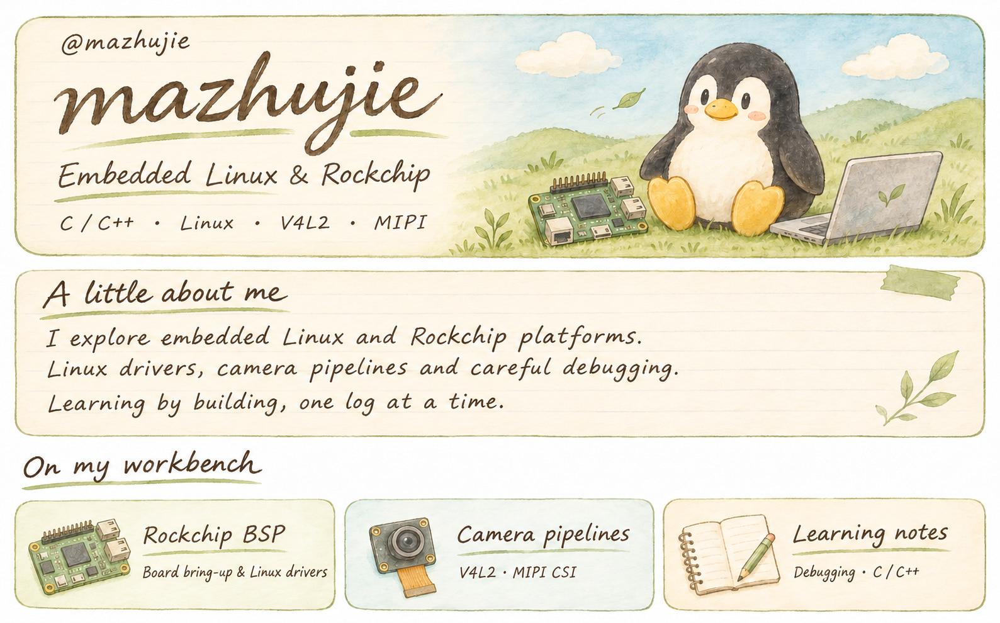

<!-- Artwork is stored in this repository. No third-party stats services required. -->
<picture>
  <source media="(max-width: 600px)" srcset="https://raw.githubusercontent.com/mazhujie/mazhujie/main/assets/profile-mobile-v2.jpg">
  
</picture>

  <a href="mailto:zhujiema@foxmail.com">
    <picture>
      <source media="(max-width: 600px)" srcset="https://raw.githubusercontent.com/mazhujie/mazhujie/main/assets/email-mobile.svg">
      
    </picture>
  </a>

关于我 · 文字版

**从一行日志，探索系统的更多可能。**

在嵌入式 Linux 的世界里持续学习与探索，记录调试过程，让每一次经验都有迹可循。

- **Rockchip BSP**：板级适配与 Linux 驱动。
- **相机链路**：V4L2、MIPI CSI。
- **学习笔记**：调试、C / C++。

联系邮箱：[zhujiema@foxmail.com](mailto:zhujiema@foxmail.com)

